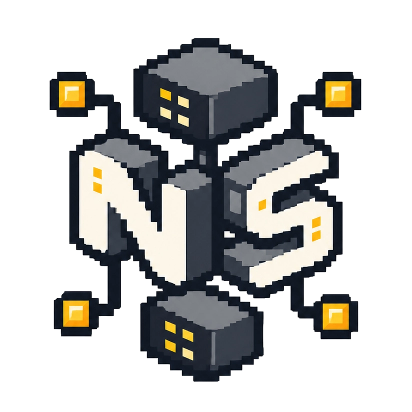
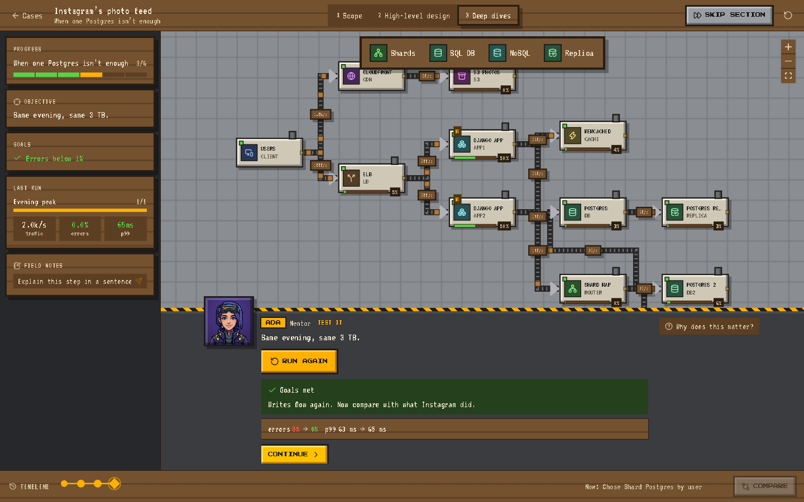
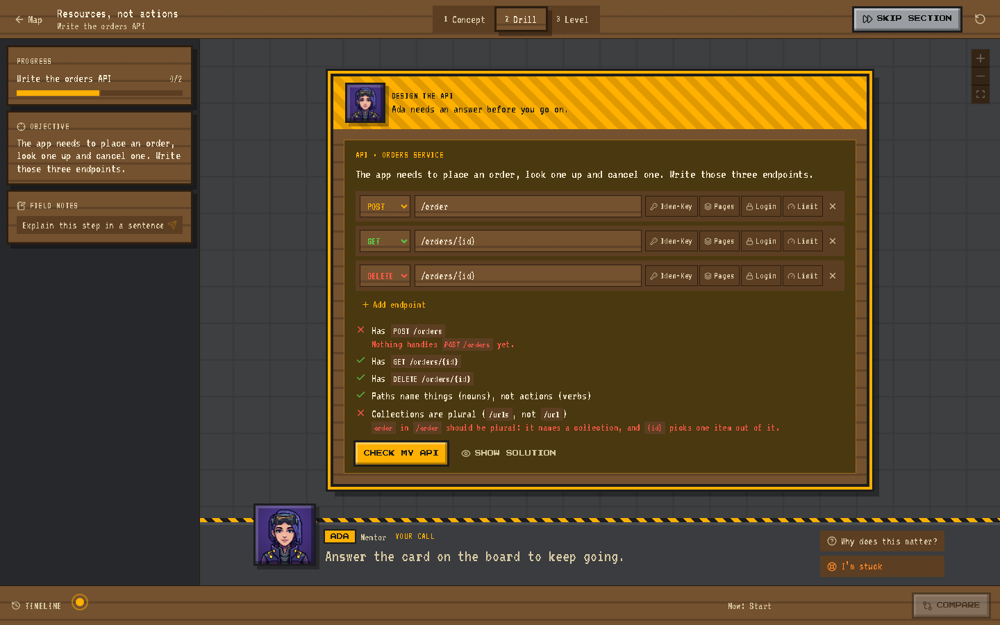
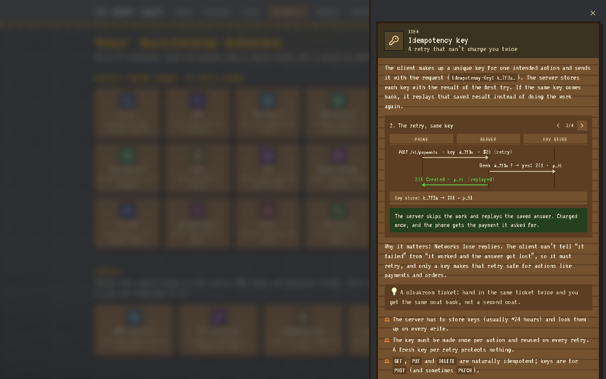
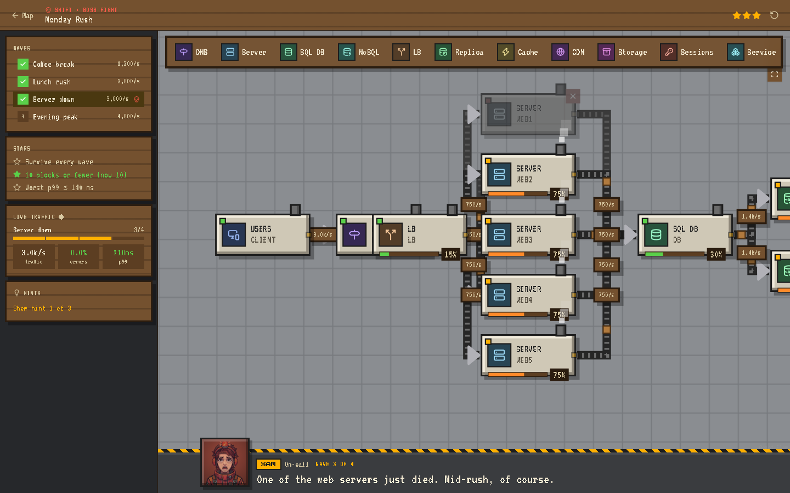
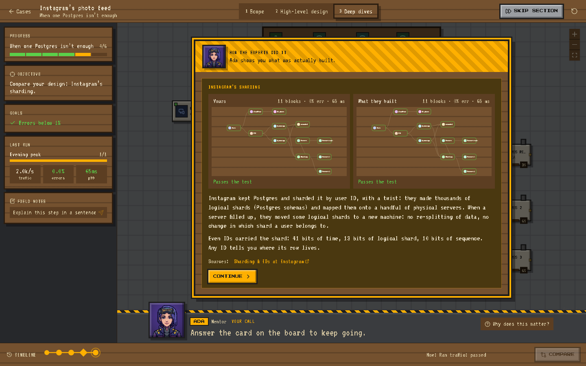
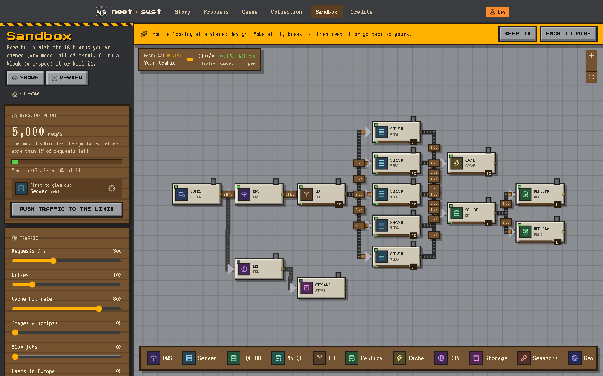
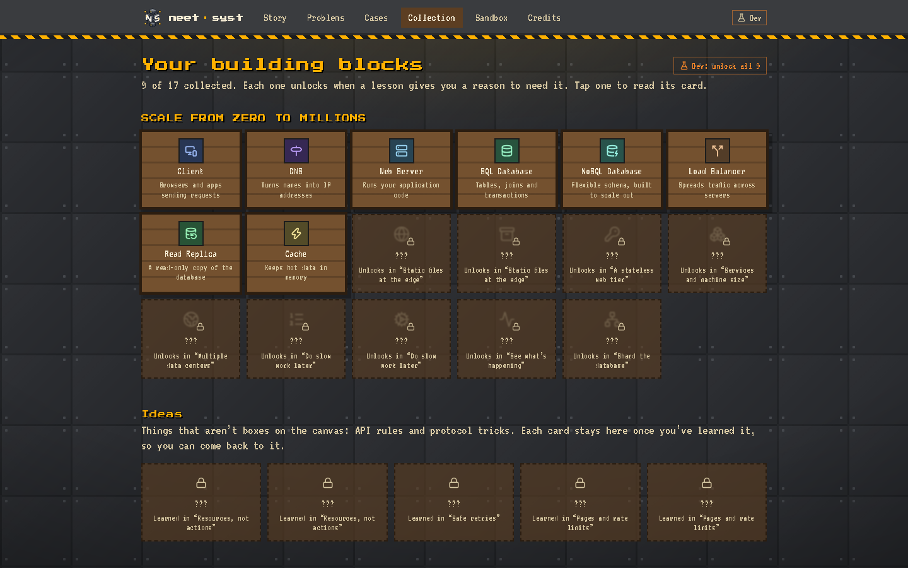

<div align="center">



# neet·syst

**LeetCode for system design, built to teach.**

Your system breaks. You unlock one new building block, learn why it exists, and use it to fix things.
No blank canvas, no 40-box diagrams, no hand-waving.

[](https://neetsystem.study)
[](https://react.dev)
[](https://www.typescriptlang.org)
[](https://vite.dev)
[](#contributing)

<br />

<a href="docs/video/neet-syst-intro.mp4"></a>

<details>
  <summary><b>Watch the 1-minute intro</b> (with sound)</summary>

  <br />

  https://github.com/user-attachments/assets/e4d4feae-72d4-47d4-9223-1e9fa4aeb5a6

  </details>


<sub><b>Story</b> · <b>Shifts</b> · <b>API design</b> · <b>Case studies</b> · <b>Problems</b> · <b>Sandbox</b></sub>

</div>

<br />

## Why this exists

Most system design resources give you a finished diagram and ask you to memorize it. Free-form simulators go the other way: an empty canvas and sixty components, which is overwhelming when you don't yet know why a load balancer exists.

neet·syst is **gated and incremental**. Every episode opens with a problem your system can't handle yet: traffic grows, a database dies, users show up in Europe. You get **one** new block, you learn the reason for it, and you watch the simulation go from failing to healthy. By the end of a chapter you've built a real architecture and know why each piece is there.

## How a lesson works

Every episode runs the same three-part loop:

| | Part | What happens |
|---|---|---|
| 1 | **Concept** | A mentor briefs you in a visual-novel dialogue. Questions pop up over the board and you have to reason through them. |
| 2 | **Drill** | A tiny, focused build. You place and wire the new block on a guided canvas, with ghost slots showing where things go. |
| 3 | **Level** | A real scenario. Run the traffic and watch your design hold or fall over. |

Every decision you make is recorded on a **branching timeline**. Rewind, take the other path, and compare the two designs side by side.

<div align="center">

<br />
<sub>A level mid-run: live traffic on every wire, load bars on every block, and the mentor in the dock below.</sub>
</div>

## What's inside

### Story: startup growth arcs

Each chapter follows a startup from its first user to millions.

- **Chapter 1, Scale from Zero to Millions:** 15 episodes, from "your first request" through databases, back-of-the-envelope estimation, load balancers, replication, caching, CDNs, stateless services, multi-region, queues, monitoring and sharding. It ends with two capstones (a URL shortener and Pastebin at 10M users) and a test-out checkpoint.
- **Chapter 2, Design the API:** resources and versioning, idempotency, and pagination plus rate limits. Services carry real endpoints, and your API choices change what the simulation does (retries really do double-charge without an Idempotency-Key).
- **Services and machine size:** rename any block, and size a service Small, Medium or Large. Learn when to scale up and when to scale out.

### API design: endpoints that change the simulation

Services carry real endpoints. You write them in a small editor (method, path, and promises like Idempotency-Key, pagination, login and rate limits), and **Check my API** grades them rule by rule. Stuck? **Show solution** fills in a correct answer.

Ideas that aren't boxes on the canvas, like idempotency keys or cursor pagination, get their own cards. Some come with a click-through diagram, and every card stays in your Collection once you've learned it.

<table>
  <tr>
    <td width="50%"></td>
    <td width="50%"></td>
  </tr>
  <tr>
    <td align="center"><sub>Every failing rule says what's wrong and why.</sub></td>
    <td align="center"><sub>The idempotency key, one scene at a time.</sub></td>
  </tr>
</table>

### Shifts: boss fights

Unscripted levels that open after milestone episodes. You get a starting design, every block you've earned, and 3–4 waves of back-to-back traffic. One wave is always chaos. Three stars to chase: survive every wave, stay at or under par blocks, keep worst p99 under target.

<div align="center">

</div>

### Problems: reps with a point

Eight standalone problems at easy, medium and hard, each with its own scenario and goals. Bakery, leaderboard, receipts, short links, bank sync and Black Friday are in.

### Case studies: what real teams built

Instagram's photo feed (2010–2012) and Twitter's home timeline, worked through in interview order: scope, estimates, the API, the high-level design, then deep dives into what broke. After each decision, a side-by-side shows your design next to what the engineers actually shipped, both run through the same test, with links to their write-ups.

<div align="center">

</div>

### Sandbox: free build with what you've earned

Only the blocks you've unlocked are available. The page shows your design's **breaking point**, meaning the most traffic it takes before 1% of requests fail, and which block gives out first. Kill any block to test failover. **Review** flags wiring mistakes and single points of failure right on the canvas. **Share** copies a link that carries the entire design.

<div align="center">

</div>

### Collection: your building blocks

Every block you unlock gets a card: what it does, when you'd reach for it, and the trade-offs. Locked ones tell you which episode earns them.

<div align="center">

</div>

### The simulation

A deterministic steady-state flow solver, so the same design always gives the same answer. It models load, latency, caches, replicas, CDNs, regions, queues, sharding, sessions, API behaviour and chaos events. It's pure TypeScript with no UI imports, and every lesson is auto-played in the test suite.

## Quick start

```bash
git clone https://github.com/kaandesu/neet-syst.git
cd neet-syst/web
npm install
npm run dev        # http://localhost:5173
```

| Command | What it does |
|---|---|
| `npm run dev` | Start the dev server |
| `npm test` | Engine and content tests (every lesson is auto-played end to end) |
| `npm run e2e` | Playwright smoke tests (first run: `npx playwright install chromium-headless-shell`) |
| `npm run typecheck` | `tsc -b` |
| `npm run lint` | oxlint |
| `npm run build` | Type-check and production build |

> [!TIP]
> **Want to look around without playing through?** Turn on **Debug mode** under Credits → Your data (or open `/?dev=1`). Every stage opens, and a **Skip section** button completes the current section like an ideal learner. `/?dev=0` turns it off.

## Project layout

```
web/src/
  engine/     pure TS: sim solver + goals, lesson runner, API rules, timeline tree (unit tested)
  content/    block catalog, chapters, problems, shifts, cases, ideas (all typed data)
  features/   canvas, mentor, timeline, lesson, map, collection, sandbox, shift, api, cases, ideas
  store/      zustand stores (progress, runs) persisted through repo/
  repo/       storage interface, so a real backend can drop in later
docs/         ROADMAP.md, CONTENT_GUIDE.md, images/
```

**Stack:** React 19, TypeScript, Vite, Tailwind CSS 4, [React Flow](https://reactflow.dev) for the canvas, Zustand, Motion, Vitest and Playwright.

## Roadmap

Progress lives in your browser's localStorage for now. Next up:

- [x] Story chapters, shifts, problems and sandbox
- [x] API design chapter and named services
- [x] Case studies built on chapters 1 and 2
- [ ] Accounts and sync (PocketBase)
- [ ] AI mentor that sees your design and your timeline
- [ ] Agentic interviewer mode: "what happens if the cache dies?"
- [ ] Score histograms for capstones (p99, block count, cost)

The full plan is in [docs/ROADMAP.md](docs/ROADMAP.md).

## Contributing

Contributions are welcome, and **content is the easiest place to start.** Lessons, problems and shifts are typed data files, not code. Read the [Content Guide](docs/CONTENT_GUIDE.md) to add an episode, a problem or a shift.

1. Fork and create a branch.
2. `npm test` and `npm run typecheck` should pass. The suite auto-plays every lesson, so a broken lesson fails CI.
3. Open a PR describing what you changed and why.

Found a lesson that's wrong or confusing? [Open an issue](https://github.com/kaandesu/neet-syst/issues). Teaching mistakes count as bugs.

## Credits

Some content is adapted from [The System Design Primer](https://github.com/donnemartin/system-design-primer) by Donne Martin, licensed under [CC BY 4.0](http://creativecommons.org/licenses/by/4.0/). The in-app Credits page has the full list.
